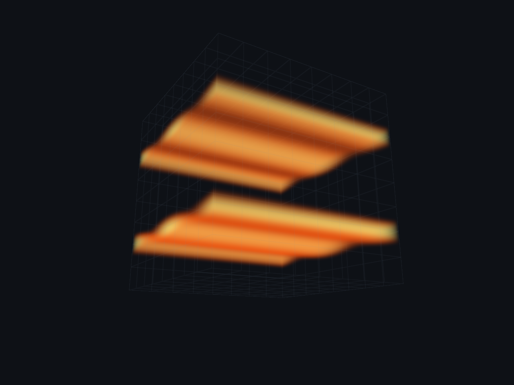
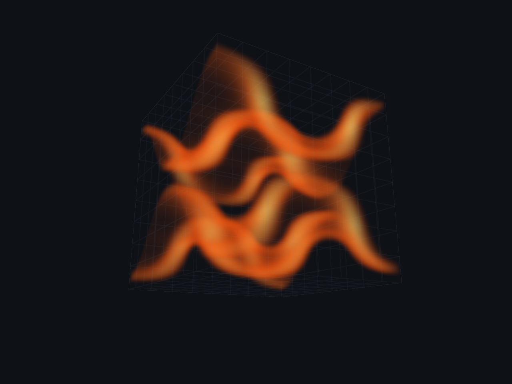
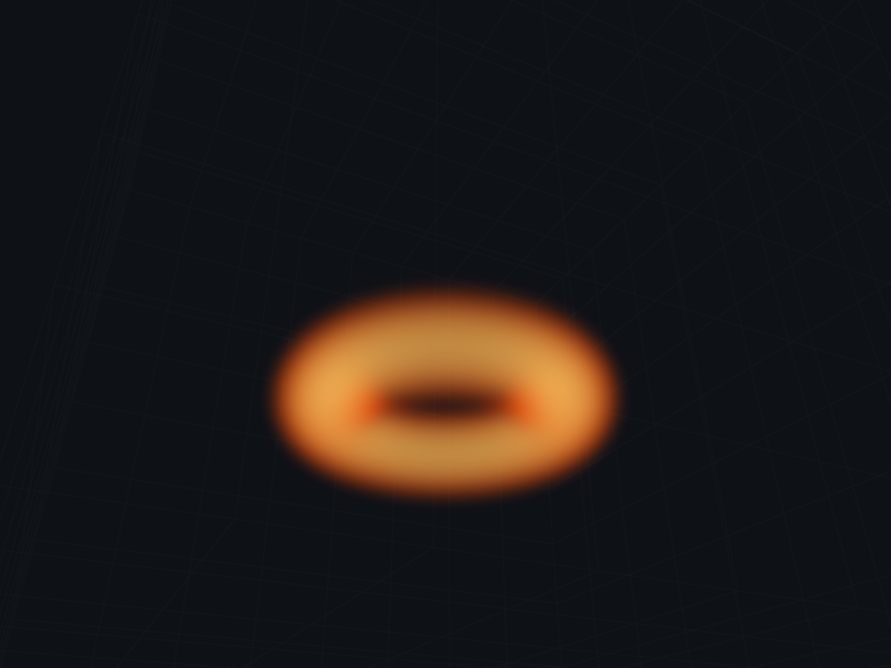
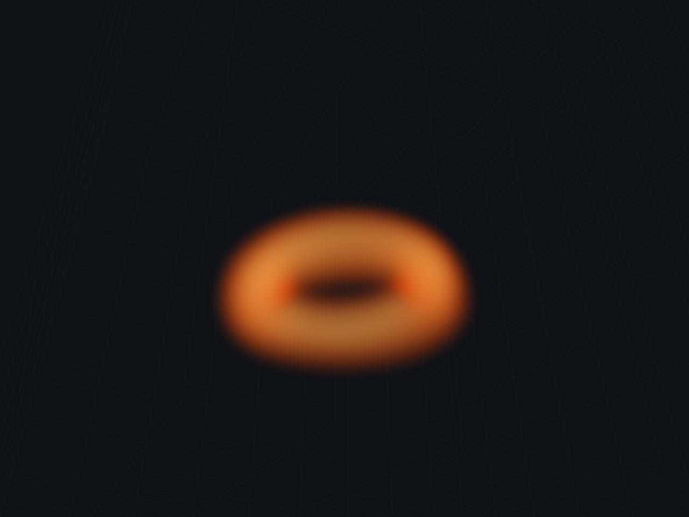
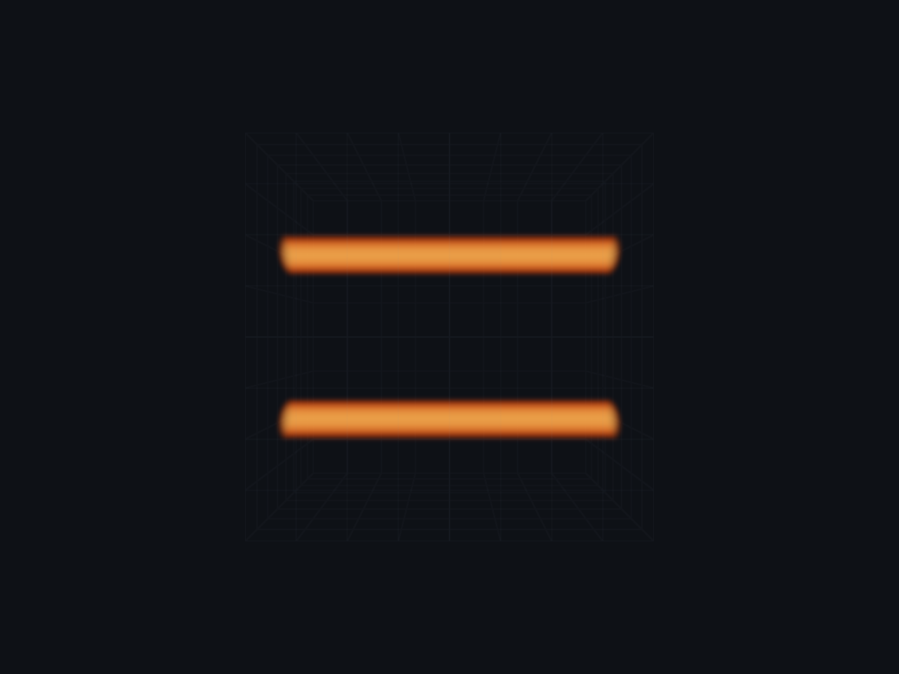
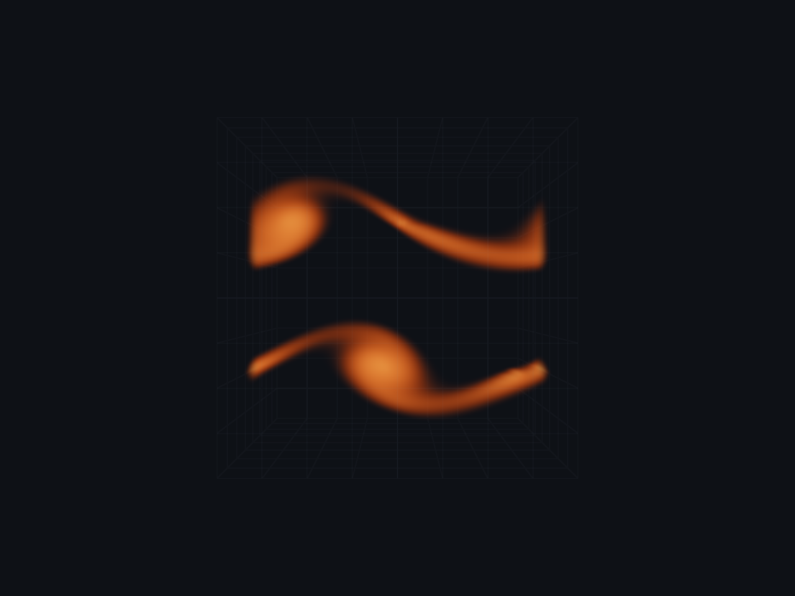

# Captured CFD showcase

## Try it interactively

```sh
git fetch origin
git switch --track origin/feature/cfd-showcase
cmake -S . -B build -DCMAKE_BUILD_TYPE=Release
cmake --build build --parallel
./build/pomelo inputs/taylor_green.json
./build/pomelo inputs/vortex_ring.json
./build/pomelo inputs/double_shear_layer.json
```

If the branch already exists locally, switch to it and fast-forward it instead
of creating it again. Close each window before launching the next example.
The existing input-deck CLI is unchanged. Left-drag to orbit.

**Start with Taylor–Green:** the dye sheets visibly fold through a three-dimensional
velocity field. The ring is a compact, self-propelled toroidal tracer; the shear
example takes longer to develop. This is a 64³ solver, so expect softening rather
than indefinitely sharp filaments. The examples use 512 pressure iterations;
older decks continue to use 64. Reducing the budget trades projection quality
for speed and changes the trajectory.

## What these images are

These are actual 1280×960 framebuffer readbacks from Pomelo's Vulkan volume
renderer, after the native compute solver advanced the stated number of steps.
They are **not** generated illustrations or CPU reconstructions. The PNG
conversion preserves the RGB bytes without enhancement, sharpening, or edits.

- Source revision: [`e6f32e6699e6bd2af0a07c08bad72ad44f77985a`](https://github.com/ac-reynolds/pomelo/commit/e6f32e6699e6bd2af0a07c08bad72ad44f77985a)
- Device: Mesa llvmpipe / LLVM 19.1.7, a software Vulkan implementation
- Simulation: 64³, fixed `dt = 1/60`, 512 weighted-Jacobi pressure iterations
- Exact input decks: committed alongside the implementation under `inputs/`
- Synchronization validation: enabled; selected captures report zero errors
- Color: raw UNORM offscreen output; an sRGB desktop presentation path can look brighter

The capture tool is surface-free because the execution environment could not
start its display server. It uses the same settings, initial conditions,
production simulation passes, and renderer. It does not test window creation,
mouse handling, or swapchain presentation. Windows/MSVC and a physical GPU were
not tested here.

## Taylor–Green: folding dye sheets

Initial state:



After **60 steps / 1.0 simulated second**:



Final pressure residual RMS / RHS RMS: `0.1101463 / 1.439826 ≈ 0.07650`.
This is not pressure convergence to the solver's configured relative tolerance.

## Vortex ring: unforced toroidal transport

Initial state:



After **30 steps / 0.5 simulated second**:



The later image shows self-induced transport and dye deformation, not a scripted
translation. A 30-step view was selected because longer runs soften the dye more
strongly through the existing semi-Lagrangian interpolation.
Final pressure residual RMS / RHS RMS: `0.09951919 / 1.43253 ≈ 0.06947`.
The ring is regularized and tapered for a periodic box; it is not an exact
unbounded-domain vortex-ring solution.

## Double shear layer

Initial state:



After **240 steps / 4.0 simulated seconds**:



The perturbed bands deform into lobes and thin connecting dye filaments. This
image does **not** resolve a textbook spiral roll-up. The 240-step checkpoint
was selected because the later 300-step image loses more of the thin tracer
through numerical diffusion. Final pressure residual RMS / RHS RMS:
`0.7373203 / 2.579422 ≈ 0.28585`; the pressure tolerance is not met.

Per-image capture metadata, source revision, and image hashes are kept in
[screenshots/](screenshots/).

## Reproduce captures

The optional tool leaves the normal application launch unchanged:

```sh
cmake -S . -B build -DCMAKE_BUILD_TYPE=Release -DPOMELO_BUILD_CAPTURE=ON
cmake --build build --parallel
./build/pomelo_capture inputs/taylor_green.json 60 taylor_green.ppm 1280 960
./build/pomelo_capture inputs/vortex_ring.json 30 vortex_ring.ppm 1280 960
./build/pomelo_capture inputs/double_shear_layer.json 240 shear.ppm 1280 960
python deployment/ppm_to_png.py taylor_green.ppm taylor_green.png
python deployment/ppm_to_png.py vortex_ring.ppm vortex_ring.png
python deployment/ppm_to_png.py shear.ppm shear.png
```

Use `0` steps for an initial-state image. An optional final argument saves
intermediate checkpoints without restarting the trajectory:

```sh
./build/pomelo_capture inputs/double_shear_layer.json 360 shear.ppm 1280 960 60
```

This writes `shear-frame000060.ppm`, `shear-frame000120.ppm`, and so on, plus
`shear.ppm` for the final requested step. Console output records simulated time,
pressure diagnostics, device, iteration budget, and validation results. Capture
is CPU-heavy on a software Vulkan implementation; those timings are not a GPU
performance benchmark.

## Verification

- Complete Release build: application, optional capture executable, and tests
- CTest: all six tests pass, including three preset trajectories and a nondefault
  odd pressure-iteration count to verify correct pressure-image selection
- CPU tests: legacy deck parity, all eight example decks, strict new-field
  validation, finite/bounded initial data, zero heat, and matching discrete
  divergence on both 64³ and odd/non-cubic test grids
- GPU tests: finite fields, bounded dye, no heat, nontrivial evolution, and a
  positive-temperature regression proving thermal-off prevents buoyant acceleration
- Python extension builds; seven non-GUI tests pass; one GUI test remains unverified
- Final-image bytes match with and without capture checkpoints in short runs
- No changes to the advection, divergence, pressure, projection, or smoke shaders

See [the assessment and equations](cfd_showcase.md) and the
[input-deck specification](../plans/input_format.md). These are qualitative
periodic incompressible-flow demonstrations, not free-surface liquid simulation,
viscous Reynolds-number benchmarks, or turbulence-resolution validation.
